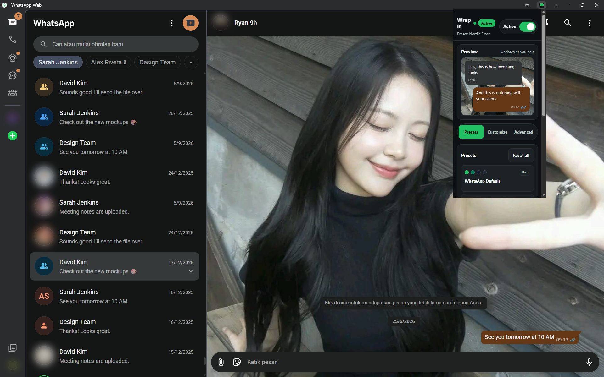
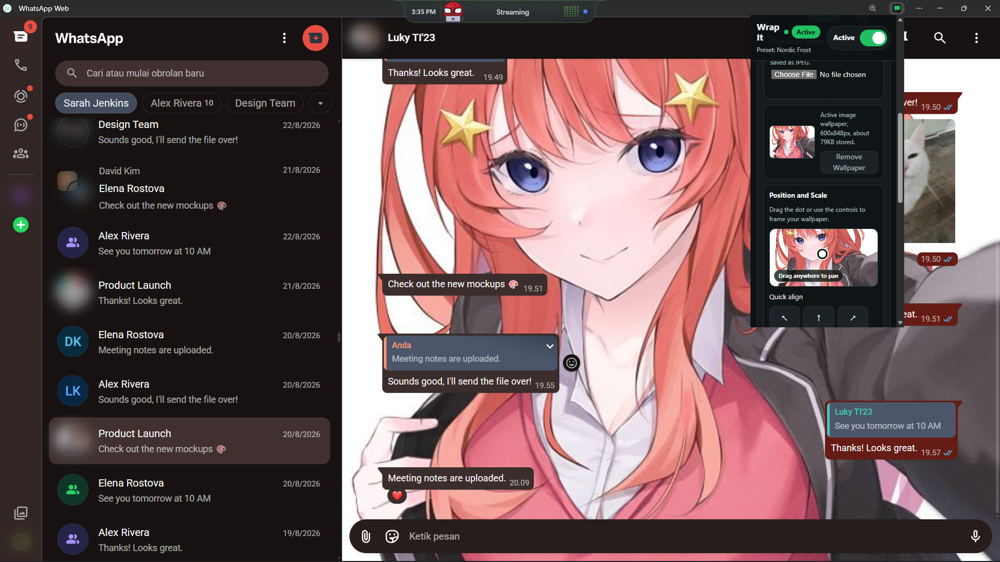
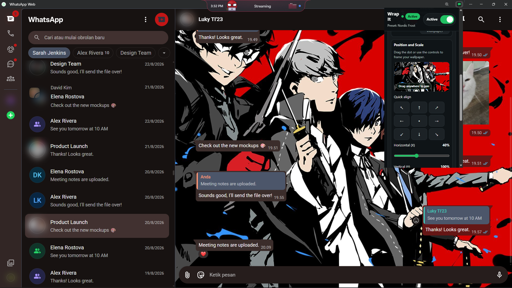

# Wrap It

Lightweight Manifest V3 extension for Chrome, Edge, and Chromium browsers. It themes WhatsApp Web with design tokens and custom wallpapers. No build step, no backend.

## Features

- Switch between 5 color presets or edit individual tokens for surfaces, bubbles, text, and lines.
- Set a custom wallpaper from a file or image URL, with drag to pan, zoom, and alignment controls.
- Match the theme to the current wallpaper in one click by sampling dominant colors.
- Add custom CSS that loads last, after the theme and wallpaper rules.
- Check token health against live WhatsApp Web with the Sentinel script in `scripts/`.

## Screenshots





## How it works

Most theme extensions break because WhatsApp Web compiles its UI with Meta StyleX into generated atomic classes like `.x1ppz1d2`, and injects local CSS variables on child elements that defeat `:root` inheritance. A rule set only on `:root` loses to those scoped values.

Wrap It injects one rule on `:root, body, #app, *, *::before, *::after` with `!important`, so scoped containers cannot override the theme. It auto-derives `-RGB` companion tokens for translucent gradients and bubble tails, and writes fallback legacy names in the same rule, such as `--accent` and `--outgoing-bubble-background`. If WhatsApp reads either the new name or the old name, the color still applies.

Wallpapers go through a compression pipeline for the same practical reasons. WhatsApp CSP blocks external image domains, and raw photos exceed Chrome storage quotas. Wrap It scales images down to max 1920px using an offscreen canvas in the popup and saves them as compact base64 JPEG data URLs, usually around 150KB.

## Installation

1. Open extension settings (`chrome://extensions` or `edge://extensions`).
2. Turn on Developer mode.
3. Click "Load unpacked" and select the `extension/` directory.
4. Open `web.whatsapp.com` and use the popup.

## Privacy and security

- Permissions are limited to `storage` for local settings and a `web.whatsapp.com` host match to inject the theme.
- Zero telemetry, zero analytics, zero remote script injection.
- Does not touch or read chat content, messages, or contacts.
- Does not automate any actions. Ban risk is zero, it works like Stylus or Dark Reader and only changes CSS.

## Sentinel

The Sentinel script audits local tokens against the live WhatsApp Web stylesheet. No login required.

```bash
python scripts/sentinel_wa_updater.py --check
python scripts/sentinel_wa_updater.py --auto-patch
```

`--check` reports verified, missing, and new candidate tokens. `--auto-patch` adds new core tokens to `extension/tokens.json`, syncs `RGB_PAIRS` in `extension/content.js`, then runs `node --check` on the content and popup scripts.

## Project structure

- `extension/` is the Manifest V3 extension with popup, content script, tokens, and icons.
- `scripts/` holds the Sentinel updater for live token audits.
- `docs/` holds planning and reference notes.
- `reports/` holds generated audit reports.

## Disclaimer

Wrap It is an unofficial third party project for personal use. It is not affiliated with, authorized, maintained, sponsored, or endorsed by WhatsApp, Meta Platforms, Inc., or any of their affiliates.
