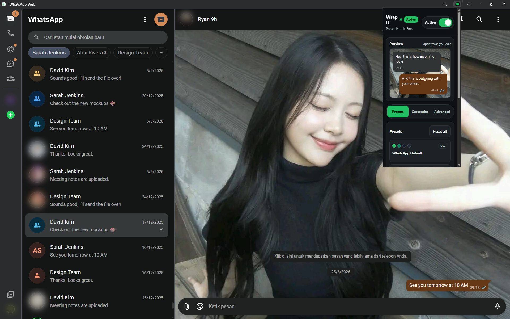
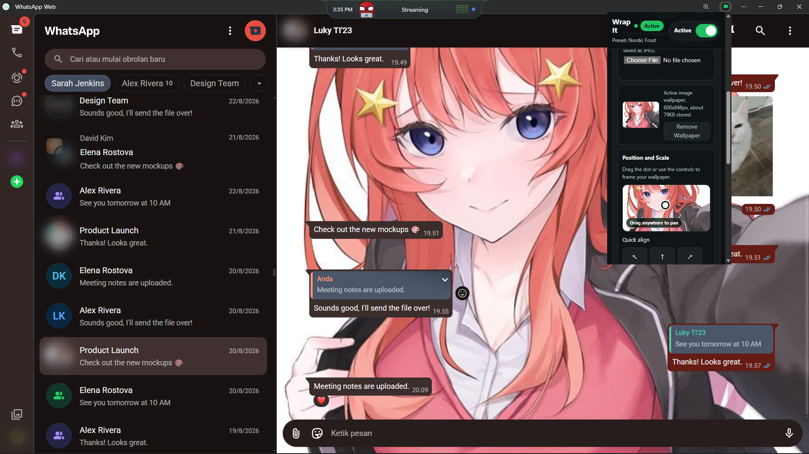
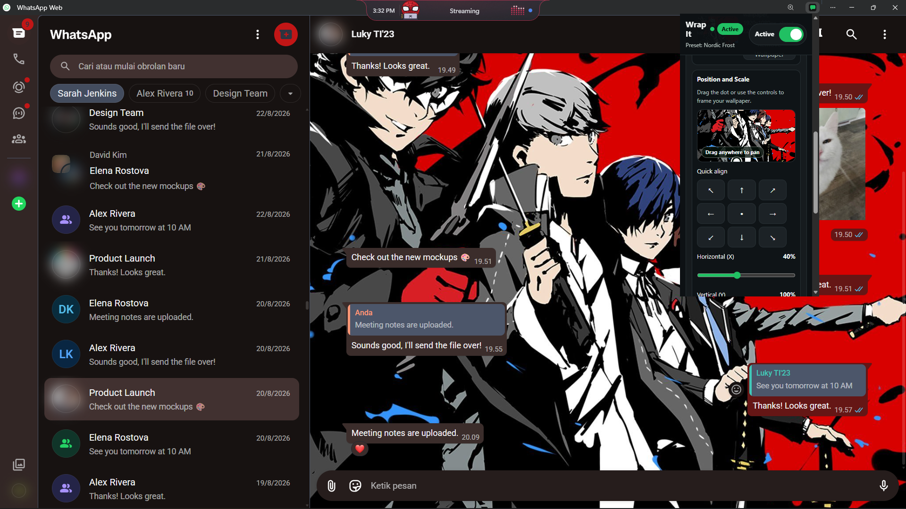

# Wrap It

Themes WhatsApp Web with WDS design tokens. No page scraping, no automation, no message access.

## Features

- Switch between 5 color presets or edit individual tokens for surfaces, bubbles, text, and lines.
- Set a wallpaper from a color, a local file, or an image link, with thumbnail preview and status text.
- Match the theme to the current wallpaper in one click by sampling dominant colors.
- Add custom CSS in the Advanced tab, applied after the theme and wallpaper rules.
- Live mini chat preview mirrors wallpaper, bubble, text, and tick colors as settings change.

## Screenshots





## How it works

Most theme extensions break because WhatsApp Web compiles its UI with Meta StyleX into generated atomic classes like `.x1ppz1d2`, and injects local CSS variables on child elements that defeat `:root` inheritance. A rule set only on `:root` loses to those scoped values.

Wrap It writes one rule on `:root, body, #app, *, *::before, *::after` with `!important`, so scoped containers cannot override the theme. It auto-derives `-RGB` companion tokens for translucent gradients and bubble tails, and writes fallback legacy names in the same rule, such as `--accent` and `--outgoing-bubble-background`. If WhatsApp reads either the new name or the old name, the color still applies. It never targets generated atomic classes, so new markup keeps working as long as standard variable names are in use.

Settings live in `chrome.storage.local` under `wrapit:settings`. The content script resolves preset values, then user overrides, then derived `-RGB` companions. It writes the result as inline properties on `document.documentElement` and as one `<style id="wrapit-engine">` tag. Wallpaper uses a separate rule limited to stable selectors such as `[data-testid="conversation-background-default_chat_wallpaper"]`. User CSS goes in `<style id="wrapit-custom-css">` and loads last. Disabling removes both style tags and every property set on the root element. A `MutationObserver` on `document.head` and `document.documentElement` restores the styles if SPA navigation drops them.

Wallpapers go through a compression pipeline for practical reasons. WhatsApp CSP blocks external image domains, and raw photos exceed Chrome storage quotas. Wrap It scales images down to max 1920px using an offscreen canvas in the popup and saves them as compact base64 JPEG data URLs, usually around 150KB. If a link fails from CORS or network limits, the popup keeps the old wallpaper and shows fetch guidance.

## Installation

1. Open extension settings (`chrome://extensions` or `edge://extensions`).
2. Turn on Developer mode.
3. Click "Load unpacked" and select the `extension/` directory.
4. Open `web.whatsapp.com` and use the popup.

## Privacy and security

- Permissions are limited to `storage` for local settings and a `web.whatsapp.com` host match to inject the theme.
- Zero telemetry, zero analytics, zero remote script injection.
- Does not touch or read chat content, messages, or contacts.
- Does not automate any actions. Ban risk is zero, it works like Stylus or Dark Reader and only changes CSS.

## Sentinel

Run from the repo root to audit local tokens against the live WhatsApp Web stylesheet. No login required.

```bash
python scripts/sentinel_wa_updater.py --check
python scripts/sentinel_wa_updater.py --auto-patch
```

`--check` reports verified, missing, and new candidate tokens. `--auto-patch` adds new core tokens to `extension/tokens.json`, syncs `RGB_PAIRS` in `extension/content.js`, then runs `node --check` on the content and popup scripts.
